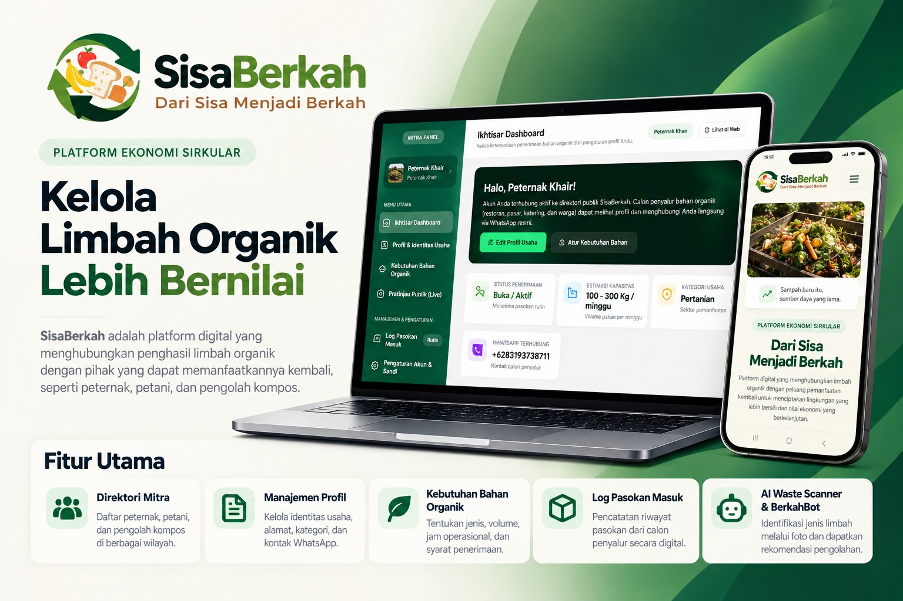

<p align="center">
  
</p>

<h1 align="center">SisaBerkah</h1>
<p align="center">
  Platform web untuk mengelola dan mendistribusikan sisa bahan organik agar lebih bermanfaat bagi mitra yang membutuhkan.
</p>

---

## 📖 Deskripsi

**SisaBerkah** adalah aplikasi berbasis web yang menghubungkan penyalur sisa bahan organik (seperti limbah pertanian dan peternakan) dengan mitra penerima yang membutuhkan. Aplikasi ini hadir untuk mengurangi pemborosan sumber daya sekaligus menciptakan nilai ekonomi dari bahan yang sebelumnya terbuang.

### Fitur Utama

- 🔍 **AI Scanner** — Analisis jenis limbah/bahan secara otomatis menggunakan kecerdasan buatan
- 🤖 **Chatbot** — Asisten virtual untuk membantu pengguna menemukan informasi seputar pengelolaan sisa bahan
- 🤝 **Direktori Mitra** — Daftar mitra penerima lengkap beserta kebutuhan bahan, lokasi, dan kontak
- 📋 **Dashboard Mitra** — Mitra dapat mengelola profil, pasokan masuk, dan data kemitraan secara mandiri
- 👤 **Manajemen Akun** — Registrasi, login, dan pengelolaan profil untuk pengguna umum maupun mitra
- 🌿 **Informasi Jenis Limbah** — Panduan lengkap mengenai kategori dan penanganan berbagai jenis bahan organik

---

## ⚙️ Persyaratan Sistem

| Kebutuhan | Versi Minimum |
|-----------|--------------|
| PHP | >= 8.3 |
| Composer | >= 2.x |
| Node.js & NPM | >= 18.x |
| Database | MySQL / SQLite |

---

## 🚀 Instalasi

```bash
# 1. Clone repositori
git clone https://github.com/username/SisaBerkah.git
cd SisaBerkah

# 2. Install dependensi PHP
composer install

# 3. Salin file environment
cp .env.example .env

# 4. Generate application key
php artisan key:generate

# 5. Sesuaikan konfigurasi database di file .env
#    DB_CONNECTION, DB_DATABASE, DB_USERNAME, DB_PASSWORD

# 6. Jalankan migrasi database
php artisan migrate

# 7. Install dependensi frontend
npm install

# 8. Build assets frontend (Tailwind CSS + Vite)
npm run build
```

---

## ▶️ Menjalankan Program

### Mode Produksi

```bash
php artisan serve
```

Akses aplikasi di browser: **http://localhost:8000**

### Mode Development (Semua Layanan Sekaligus)

```bash
composer run dev
```

> Perintah ini menjalankan Laravel server, queue worker, dan Vite secara bersamaan dalam satu terminal.

---

## 📁 Struktur Direktori Utama

```
SisaBerkah/
├── app/Http/Controllers/   # Logic utama aplikasi
├── database/migrations/    # Skema database
├── resources/              # Tampilan (views) & assets frontend
├── routes/web.php          # Definisi seluruh rute aplikasi
└── public/                 # File yang dapat diakses publik
```
